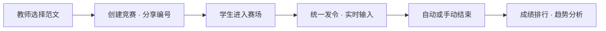

<div align="center">

# ⌨️ KeySprint

### 键跃 · READY // TYPE // SPARK

**面向课堂的中文打字训练与实时竞赛系统**

发令一响，文字在指尖起跑。


</div>

> 「准备——开始！」教师统一发令，学生同步开赛；每一次击键都有提示，每一段进步都有记录。

KeySprint（键跃）是一套可自托管的中文输入课堂工具。教师选择范文并创建限时竞赛，学生通过比赛编号进入赛场，系统实时呈现拼音提示、输入反馈、速度、正确率与完成进度，并在赛后生成个人和班级分析。

## ✦ 一场竞赛，三种视角

| 学生赛场 | 教师工作台 | 系统能力 |
| --- | --- | --- |
| 比赛编号快速加入 | TXT 范文上传、编辑与共享 | Go 单进程托管 API 与前端 |
| 手动填写或从班级名单选择身份 | 多场竞赛并行创建与统一发令 | WebSocket 实时同步比赛状态 |
| 逐字拼音提示，可按场次关闭 | 在线学生名单、手动/自动停赛 | SQLite WAL 本地持久化 |
| 中文输入法组合输入与即时纠错 | Excel 班级名单导入与同步 | Docker Compose 一键部署 |
| 刷新恢复进度，迟到自动转为练习 | 明细、个人/班级趋势与成绩导出 | 兼容旧版数据和账号迁移 |



## ✦ 快速启动

需要 Docker 与 Docker Compose 插件。

```bash
git clone https://github.com/Alumos/KeySprint.git
cd KeySprint
cp .env.example .env
```

编辑 `.env`，将 `JWT_SECRET` 换成长随机字符串；可以使用 `openssl rand -hex 32` 生成。随后启动：

```bash
docker compose up -d --build
```

访问 `http://服务器地址:8080`。首次打开会进入初始化页面，创建第一个系统管理员账号。

```bash
docker compose ps
docker compose logs -f keysprint
```

SQLite 数据默认保存在 Compose 卷 `keysprint_data` 的 `/data/keysprint.db` 中。升级镜像不会删除该卷。

## ✦ 本地开发

需要 Go 1.24+ 与 Node.js 22+。

```bash
cd frontend
npm install
npm run dev
```

另开终端启动后端：

```bash
cd backend
ADDR=:8080 DB_PATH=./data/keysprint.db PUBLIC_DIR=../frontend/dist go run .
```

前端开发地址为 `http://localhost:5173`，Vite 会将 `/api` 与 `/ws` 代理到 `http://localhost:8080`。

运行完整验证：

```bash
make test
```

## ✦ 技术结构

```text
KeySprint/
├── frontend/          React 19 + TypeScript + Radix UI + Vite
├── backend/           Go + SQLite + WebSocket
├── Dockerfile         前后端多阶段构建，输出单个运行镜像
├── docker-compose.yml 本地构建与持久化部署
├── .env.example       运行和外部集成配置示例
└── Makefile           开发、构建与测试入口
```

前端为教师控制台与学生赛场提供响应式界面；后端同时提供 REST API、WebSocket、静态文件托管和竞赛计时。部署时只有一个 Go 服务与一个 SQLite 数据库，适合教师电脑、校园局域网或小型 VPS。

## ✦ 连接 ClassOrbit

KeySprint 可以从 [ClassOrbit](https://github.com/Alumos/ClassOrbit) 同步当前教师管理的班级和学生名单。系统管理员可在“积分系统配置”中维护服务地址、接口路径、共享密钥与超时时间，配置会写入本地数据库并立即生效。

同步只发送当前教师用户名和可选的共享 Bearer 密钥，不会转发教师密码或 KeySprint 登录令牌。远端应只返回该教师有权管理的班级：

```json
{
  "classes": [
    {
      "id": "class-001",
      "name": "三年级一班",
      "students": [{ "id": "1001", "name": "张三" }]
    }
  ]
}
```

班级 `id` 应保持稳定。同步以远端名单为准：改名会更新原班级，删除会在 KeySprint 中停用，已有成绩仍通过班级 ID 保持关联。

## ✦ 配置

| 变量 | 默认值 | 说明 |
| --- | --- | --- |
| `PORT` | `8080` | Docker 对外端口 |
| `TZ` | `Asia/Shanghai` | 服务时区 |
| `JWT_SECRET` | 无 | 生产环境必须设置的登录签名密钥 |
| `CLASS_SYSTEM_URL` | 空 | ClassOrbit 或其他班级系统地址 |
| `CLASS_SYSTEM_PATH` | `/api/integration/classes` | 班级同步接口路径 |
| `CLASS_SYSTEM_TOKEN` | 空 | 可选的共享 Bearer 密钥 |
| `CLASS_SYSTEM_TIMEOUT` | `8s` | 外部同步请求超时 |
| `GOPROXY` | `https://goproxy.cn,direct` | Go 构建代理 |
| `NPM_REGISTRY` | `https://registry.npmmirror.com` | npm 构建镜像 |
| `ALPINE_MIRROR` | `https://mirrors.aliyun.com/alpine` | Alpine 软件源 |

海外部署可以将三个构建镜像变量改为官方源。

## ✦ 数据与升级

KeySprint 启动时会自动补齐数据库结构和索引；同一学生在同一竞赛中重复提交时，只保留正确字数更多、速度更高的一次成绩。升级前请先备份数据库，不要让多个服务同时写入同一个文件。

## ✦ 数据备份

SQLite 使用 WAL 模式。请停止服务后再复制主数据库，确保备份一致：

```bash
docker compose stop keysprint
docker compose cp keysprint:/data/keysprint.db ./keysprint-backup.db
docker compose start keysprint
```

生产环境建议在 KeySprint 前配置 Caddy、Nginx 等 HTTPS 反向代理，并妥善保管 `.env`、数据库备份与 ClassOrbit 共享密钥。
